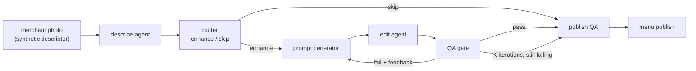

# Jagadish-visual-content-agents

End-to-end visual-content agents for the fictional food marketplace
**Savorlane** (a fictional name; a web check on 2026-10-28 found no
exact-match real business under that name). Small merchants upload
phone photos of uneven quality; this pipeline decides which photos to
enhance, enhances them in a QA-gated loop, and publishes only what
passes a second, independent gate.

> **Synthetic demo data, fake backends.** No real photos are read and
> no real vision or image models run anywhere in this repo. Photos are
> synthetic descriptors, and the vision/edit backends are deterministic
> fakes (see `docs/adr-001-fake-backends.md`). This repo proves
> routing, QA, eval, and loop machinery -- not photo-editing quality.
> Nothing here is deployed. This is an independent portfolio project,
> not affiliated with any real company.

## Recruiter summary

- **Problem:** marketplace food photos vary wildly in quality, but
  customers trust only photos that look like what will actually
  arrive. Enhancing everything wastes compute and risks degrading
  good photos; enhancing carelessly invents dishes.
- **Approach:** describe -> rubric router (enhance/skip, cost-tiered)
  -> image-specific prompt -> bounded edit loop with multi-dimensional
  QA -> pairwise eval -> redundant publish QA, all logged as flat JSON.
- **Proof (demo regression set, 13 fixtures, real runs):** router
  precision 0.889 / recall 0.889 (recall is the guardrail); pass@K
  0.111 -> 0.556 -> 0.667; 3 coverage hits; 2 leakage catches; 0
  published-bad; 101 tests green.

## Purpose and who it is for

For anyone building an agent pipeline where the output is customer-
visible and must stay truthful: food marketplaces, catalogues, and
listing platforms. The transferable patterns are rubric routing with
recall guardrails, QA-gated edit loops with pass@K, pairwise
generation evals with an honest "unsure", Swiss-cheese publish gates,
and flat run logs that make every decision auditable.

## Architecture



Full diagrams and design notes: `knowledge/architecture.md`,
`knowledge/design-notes.md`, `knowledge/router-eval.md`,
`knowledge/feedback-loops.md`.

## How it works, step by step

1. **Describe.** A fake vision backend turns a descriptor into a
   structured description: dish, counts, quality scores, objects,
   style flags, and issues. Deterministic and offline.
2. **Route.** A rubric grades sharpness, composition, color, plating,
   and count. Any failed criterion routes to enhancement with an
   image-specific directive; a photo passing everything is skipped
   and the original is kept. The photo is also assigned an edit tier
   (lite / standard / pro) trading cost vs latency vs quality.
   Tier prices are illustrative demo prices for fake tiers, and cost
   or latency inputs must be non-negative.
3. **Prompt.** The prompt generator builds an image-specific prompt
   from the description, the router's directives, and accumulated QA
   feedback. A diversity check proves prompts differ per photo (demo:
   13/13 unique, max pairwise similarity 0.846).
4. **Edit loop.** The fake editor improves each targeted dimension
   by one bounded step (+0.20, capped at 0.95) per iteration. It never
   changes dish identity, objects, counts, plating style, or brand
   tokens. QA re-checks after every iteration; feedback accumulates
   into the next prompt. Up to K iterations (default 3).
5. **QA gate.** Seven dimensions, each pass/fail with a reason:
   plating, faithfulness, colors, completeness, naturalness, count,
   remediation. Counts are a safety property: editing can never
   repair a count mismatch or verify an unverifiable count, so those
   photos fail every iteration.
6. **Pairwise eval.** Input vs output judged better yes/no/unsure on
   faithful / complete / natural / realistic plus a meaningful-
   improvement bar. "Unsure" covers nugatory changes and unverifiable
   counts -- neither is reported as a win.
7. **Publish QA.** A redundant final gate that independently
   re-checks policy, brand tokens, dish identity, overlay text,
   count, and a stricter quality floor (0.75 vs QA's 0.70). It takes
   no QA verdict parameter, so there is nothing to forge. A rejected
   enhanced candidate falls back to the original photo.
8. **Log.** One flat JSON record per run plus an aggregate rollup
   (routes, pass@K, coverage hits, leakage, published variants,
   failure classes).

## Real code excerpts and their real output

Run one photo through the pipeline:

```python
from visual_content import run_pipeline
from visual_content.fixtures import DIM_RAMEN, BLURRY_NOODLES
run_pipeline(DIM_RAMEN)
run_pipeline(BLURRY_NOODLES)
```

Real output (flat run records, from an actual run):

```json
{
  "run_id": "run-dim-ramen",
  "route": "enhance",
  "tier": "lite",
  "iterations": 1,
  "qa_pass_iteration": 1,
  "qa_passed": true,
  "coverage_hit": false,
  "pairwise_verdict": "yes",
  "published_variant": "original",
  "publish_reasons": [
    "below_publish_floor: sharpness",
    "all publish checks pass"
  ],
  "failure_classes": ["publish_floor"]
}
```

This record is the leakage story in miniature: the candidate passed
QA at 0.70 but failed the stricter publish floor at 0.75, so the
original was published instead. The record keeps both reason lists,
so the fallback is auditable, not silent.

Full demo output (`python3 scripts/render_demo.py`):

```text
demo fixtures: 13
router confusion: TP=8 FP=1 FN=1 TN=3
router precision: 0.889
router recall (guardrail): 0.889
router accuracy: 0.846
tier accuracy: 0.875 over 8 routed items
tier matrix (gold, predicted) -> count:
  ('lite', 'lite'): 1
  ('pro', 'pro'): 1
  ('standard', 'lite'): 1
  ('standard', 'standard'): 5
  tier lite: precision=0.500 recall=1.000
  tier pro: precision=1.000 recall=1.000
  tier standard: precision=1.000 recall=0.833
pipeline routes: {'skip': 4, 'enhance': 9}
pass@K: [0.111, 0.556, 0.667]
coverage hits: 3
leakage reached publish QA: 2
published enhanced: 4
published original: 9
published none: 0
published bad: 0
failure classes: {'publish_floor': 2, 'plating': 1, 'count': 1, 'remediation': 2}
total edit cost (demo tier prices): $0.71
prompt diversity: 13/13 unique, max similarity 0.846, passed=True
```

All figures above are demo regression-set numbers (13 hand-written
fixtures with hand-assigned gold labels), not quality claims about
real photos. The one router false positive is the artistic dessert
(stylised plating flagged, gold label keeps it as a signature style);
the one false negative is the borderline bowl (clears the router's
0.60 bar, gold bar is 0.65).

## How to run

```bash
python3 -m pytest tests -q        # full suite (101 tests)
python3 scripts/render_demo.py    # demo numbers above
python3 scripts/count_tests.py    # real test total
python3 scripts/brand_check.py    # fictional-names guard
```

Stdlib only, Python 3.12, offline. No keys, no network, no model
calls. There is deliberately no `.github/workflows` directory in this
scaffold: CI is added by a second writer before the repo is pushed.

## Guardrails and security controls

- **Every gate fails closed.** Missing candidates, missing scores,
  and unverifiable counts fail rather than slipping through. Tests
  cover bypass (no QA-verdict parameter exists to forge), reject,
  and absent paths for the QA and publish gates.
- **Counts are never guessed.** A count mismatch or an unverifiable
  claimed count withholds enhancement (coverage hit) instead of
  publishing invented items.
- **Brand preservation.** The editor never touches brand tokens;
  publish QA rejects any brand change, and a test proves publish QA
  catches a brand change the QA gate never checks.
- **Fictional names only.** `scripts/brand_check.py` scans every repo
  file against a SHA-256-hashed blocklist of real-company names (the
  names themselves are never stored in plain text); a test asserts
  the blocklist is non-empty and the scan is clean.
- **Real numbers only.** Every figure in this README comes from
  `scripts/render_demo.py` or the test suite, and the suite asserts
  the demo numbers as regression checks.

## Limitations and known failures

Short version; full list in `docs/limitations.md`:

- Fake backends, hand-assigned gold labels, hand-set thresholds,
  13 fixtures. Rates are regression checks with wide uncertainty.
- The editor only moves scores; staging problems, counts, and
  unrealistic presentations become coverage hits by design.
- Originals are judged on policy, not beauty, at publish QA.

## Built vs planned

| Item | Status |
|------|--------|
| Describe -> route -> edit loop -> QA -> publish QA pipeline | Built |
| Router eval (confusion matrix, precision/recall, n-by-n tier matrix) | Built |
| Pass@K, coverage hits, leakage measurement, flat JSON log + rollup | Built |
| Pairwise eval (yes/no/unsure) and 5-class failure taxonomy | Built |
| Prompt diversity check, brand-preservation check, hashed brand guard | Built |
| knowledge/ design notes + Mermaid docs, docs/ guides | Built |
| Real vision-model adapters (needs keys + cost approval) | Planned |
| Outer tuning loop: gold labels, drift sampling, diagnoser, reflect/synthesise autotuner with config versioning + rollback | Planned (companion repo) |
| Deployment, hosted demo, CI workflows | Planned (CI added by second writer; deployment deferred) |

## Further reading

- `docs/implementation-guide.md` -- extend fixtures, dimensions, tiers.
- `docs/interview-points.md` -- sixty-second talk tracks.
- `docs/limitations.md` -- what this repo does not prove.
- `docs/threat-model.md` -- threats and controls.
- `docs/adr-001-fake-backends.md` -- why the backends are fake.
