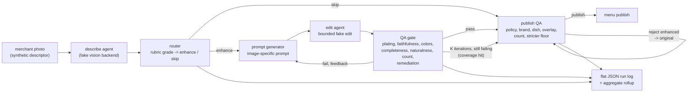
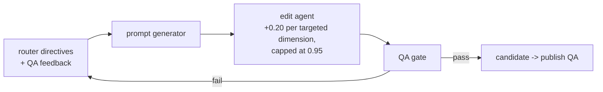

# Architecture

## End-to-end pipeline

## Edit loop (detail)

Notes:

- The loop is bounded by K iterations (default 3). A candidate that
  never passes is withheld; the original photo goes to publish QA.
- The editor never changes dish identity, objects, counts, plating
  style, or brand tokens. Those are exactly the things QA and publish
  QA verify, so a "fix" cannot be a fabrication.
- Publish QA never trusts the QA gate's verdict: it takes only
  (original, candidate) and derives every check itself. There is no
  verdict parameter to forge, so skipping QA cannot be papered over.

## Flat run log

One record per run, one level of keys: route, tier, iterations,
QA pass iteration, pairwise verdict, publish decision, published
variant, reasons, and failure classes. The rollup aggregates routes,
pass@K, coverage hits, leakage (candidates that passed QA but failed
publish QA), published variants, and failure-class counts.
