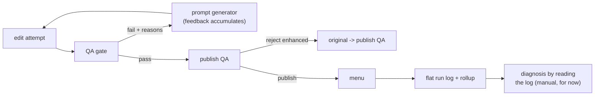

# Feedback loops in this repo (and what comes next)

## Loops implemented here

- **Edit loop (automatic):** QA feedback returns to the prompt
  generator, which accumulates it across iterations. Measured by
  pass@K. Demo: pass@K = [0.111, 0.556, 0.667] over 9 enhanced
  attempts at K = 1, 2, 3.
- **Coverage feedback (automatic):** photos that never pass QA are
  withheld and counted as coverage hits (demo: 3 of 9 enhanced
  attempts). A rising coverage-hit rate says the router is sending
  unfixable photos for enhancement.
- **Leakage feedback (automatic):** candidates that pass QA but fail
  publish QA are counted as leakage (demo: 2, both in the 0.70-0.75
  band between the QA floor and the stricter publish floor). A rising
  leakage rate says the QA gate's bar is too loose.

## Loops deliberately NOT in this repo

A companion repo (planned, approved) will add the outer tuning loop:
gold human-label sets, production sampling for drift, a diagnoser that
localises which agent to tune across several feedback sources, and a
reflect/synthesise autotuner that rewrites agent configs behind a
benchmark gate with versioning and rollback. This repo stops at the
point where that loop would plug in: the flat run log is its input,
and the failure-class counts are its signal.
