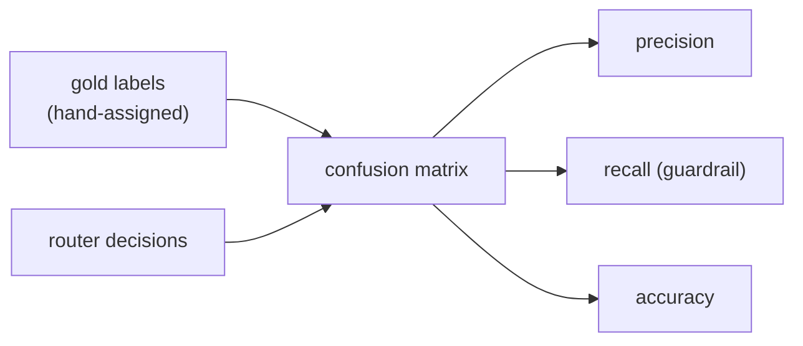

# Router evaluation

## Binary enhance/skip eval

The router is a classifier. Gold labels play the role of human labels:
they are hand-assigned in `visual_content/fixtures.py` and deliberately
differ from the router rubric on two boundary photos, because a router
eval that agrees with its own rubric by construction proves nothing.

Demo-set result (13 fixtures, from `scripts/render_demo.py`):

|              | Gold enhance | Gold skip |
|--------------|--------------|-----------|
| Pred enhance | 8 (TP)       | 1 (FP)    |
| Pred skip    | 1 (FN)       | 3 (TN)    |

- Precision 0.889, recall 0.889, accuracy 0.846.
- The false positive is the artistic dessert: the router flags its
  stylised plating as unrealistic, while the gold label keeps it as the
  merchant's signature style. Cost: wasted compute, no quality gain.
- The false negative is the borderline bowl: every score clears the
  router's 0.60 bar, but the gold label (0.65 bar) says enhance. This
  is the guardrail failure mode -- a mediocre photo approved as-is.

## Tier routing eval (n-by-n matrix)

Photos the router enhances are also assigned an edit tier (lite /
standard / pro) trading cost against latency against quality. The
gold tier rule grades against 0.65 while the router grades against
0.60, so boundary photos separate them:

| Gold \ Pred | lite | standard | pro |
|--------------|------|----------|-----|
| lite         | 1    | 0        | 0   |
| standard     | 1    | 5        | 0   |
| pro          | 0    | 0        | 1   |

- Tier accuracy 0.875 over 8 routed items.
- The single miss is the off-centre pizza: gold standard, router lite.
- Per-tier: lite precision 0.500 / recall 1.000; standard precision
  1.000 / recall 0.833; pro precision 1.000 / recall 1.000.

## Why recall is the guardrail

A false positive costs one wasted edit. A false negative leaves a bad
photo on the menu, where customers see it. The router therefore
optimises recall on the "needs enhancement" class, and the demo
regression set holds recall at or above 0.80. That threshold is a
property of this 13-fixture demo set, not a quality claim about real
photos.
